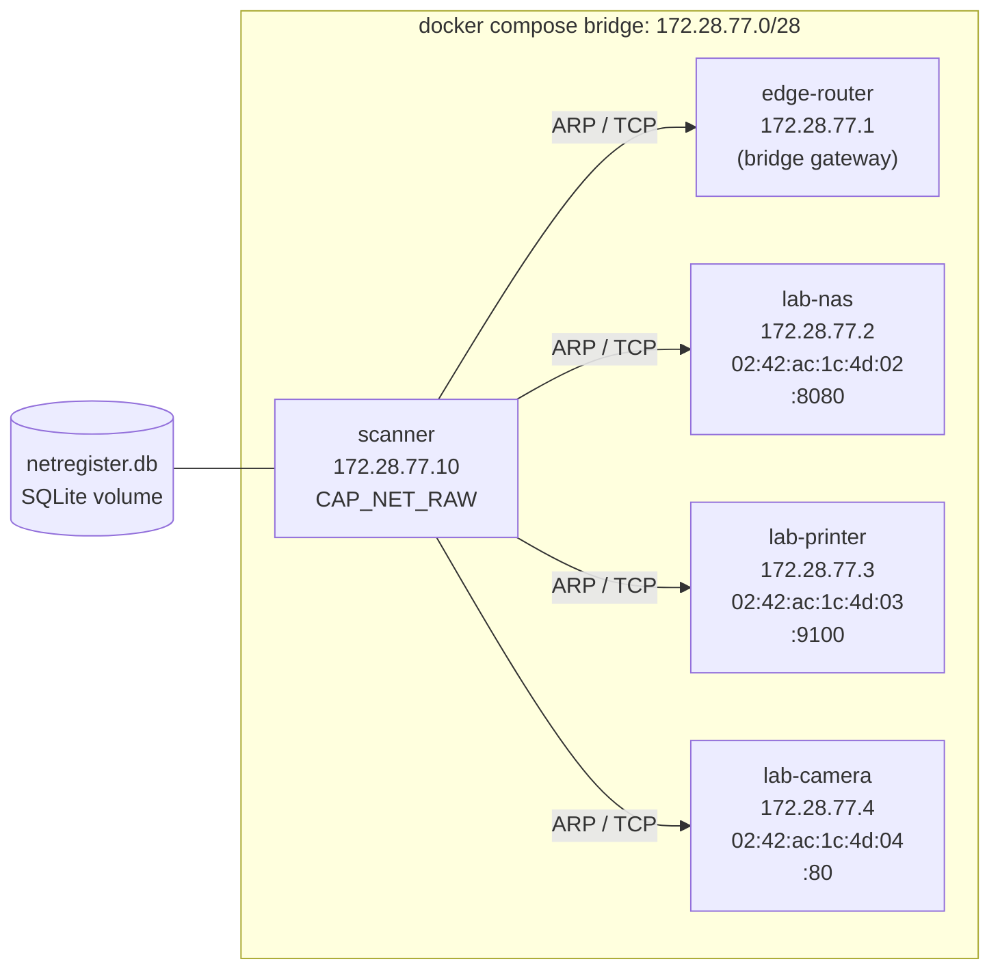

# netregister

[](https://github.com/cashewna/netregister/actions/workflows/ci.yml)

A small, honest network asset register for **one local network segment**. It
finds hosts with ARP, records them in SQLite, and answers the IT support
question: *what equipment do we have, and when was it last seen?*

Tracked per host: **MAC, IP, hostname, owner, location, first seen, last seen,
and open TCP ports**.

## Legal and ethical boundary

**Scan only networks you own or administer, or networks for which you have
documented written authorisation.** Unauthorised scanning can break policy and
law even when it is technically harmless. This tool sends ARP requests and TCP
connection attempts to every address in the target range.

The scanner enforces this boundary in code: a target network must be equal to,
or inside, a network listed in `scanner.allowed_networks`. Anything else is
refused with exit code `2` before a packet is sent. `--allow-unlisted-network`
is an explicit one-run override for lab work; it prints a warning and should
only be used on a network you are authorised to scan. Do not add a broad range
"just in case".

## What it does and does not do

In scope:

- ARP discovery on the local L2 segment, including MAC addresses.
- SQLite inventory with migrations and idempotent upserts keyed by MAC.
- Operator metadata (hostname, owner, location) from a TOML config.
- TCP connect checks for a configured port list.
- CLI for scanning, listing and counting.
- An isolated Docker Compose proof that never touches the real LAN.

Out of scope: dashboards, web UI, cloud discovery, credential-based inventory,
SNMP, continuous monitoring and alerting.

## Build and test

Requires Rust. The toolchain is pinned in `rust-toolchain.toml` and the
dependency set is locked in `Cargo.lock`.

```console
$ cargo test
$ cargo build --release
```

Discovery needs `CAP_NET_RAW`, so run the binary as root or grant the
capability:

```console
$ sudo ./target/release/netregister --config config/example.toml \
    scan --network 192.168.1.0/24
```

`cargo test` covers the register upsert rules (one row per MAC, immutable
`first_seen`, advancing `last_seen`, preserved operator metadata), allow-list
refusal, ARP frame parsing, port detection, timestamp formatting and network
enumeration. No test needs root or a live network.

## Configuration

```toml
[database]
path = "/var/lib/netregister/netregister.db"

[scanner]
interface = "eth0"
allowed_networks = ["192.168.1.0/24"]   # the only ranges you may scan
ports = [22, 80, 443, 8080, 9100]
timeout_ms = 1000

[[assets]]
mac = "02:42:ac:1c:4d:02"               # preferred key: survives DHCP changes
hostname = "lab-nas"
owner = "IT Lab"
location = "Rack A, shelf 2"

[[assets]]
ip = "192.168.1.1"                      # IP is a fallback key (e.g. a gateway)
hostname = "edge-router"
owner = "Network Operations"
location = "Comms cupboard"
```

An asset needs `mac`, `ip`, or both. `mac` wins when both match. MAC matching is
case-insensitive and accepts `:` or `-` separators. The database path is created
if its parent directory is missing.

## CLI

```console
$ netregister --config netregister.toml scan --network 192.168.1.0/24
scan network=192.168.1.0/24 discovered=27 inserted=4 updated=23 unchanged=0 new_ports=1 closed_ports=0

$ netregister --config netregister.toml list
MAC                IP               HOSTNAME            OWNER             LOCATION              FIRST SEEN            LAST SEEN             PORTS
02:42:ac:1c:4d:02  192.168.1.42     lab-nas             IT Lab            Rack A, shelf 2       2026-11-05T11:24:48Z  2026-11-05T11:24:53Z  8080
...

$ netregister --config netregister.toml stats --format tsv
27	31
```

`list` and `stats` accept `--format table|tsv|json`. `scan` accepts `--json`.
A scan target outside the allow-list exits `2`:

```console
$ netregister --config config/example.toml scan --network 10.99.0.0/24
refusing to scan: target network 10.99.0.0/24 is not within the configured allow-list [192.168.1.0/24]
hint: add the network to scanner.allowed_networks, or pass --allow-unlisted-network to widen the allow-list for this run
```

Other failures exit `1`.

## Schema

SQLite `user_version = 1`:

- `hosts(id, mac UNIQUE, ip, hostname, owner, location, first_seen, last_seen)`
  — one row per MAC. `first_seen` is write-once; `last_seen` advances on every
  observation; metadata columns keep their last non-null value.
- `open_ports(host_id, port, first_seen, last_seen, PRIMARY KEY(host_id, port))`
  — ports seen on the latest scan; stale ports are deleted.

Migrations run automatically when the store opens.

## Isolated compose proof

The proof creates a dedicated Docker bridge network (`172.28.77.0/28`) and
never sends traffic outside it. The bridge gateway is the router host; the
three labelled Alpine containers are the devices.



Run it from a clean checkout:

```console
$ ./scripts/run-proof.sh
```

or directly:

```console
$ docker compose up --build --abort-on-container-exit --exit-code-from scanner
```

The scanner container deletes its database, verifies that an unlisted network
is refused, scans, waits two seconds, scans again, prints both summaries and
the host row counts, and asserts:

- exactly the router and the three labelled containers are discovered;
- scan 1 inserts 4 rows; scan 2 inserts 0 and updates 4;
- the host row count is 4 after both scans;
- `first_seen` is unchanged and `last_seen` advances for every host;
- the expected per-device open ports are recorded.

Recorded output from this repository:

```text
=== scan 1 ===
scan network=172.28.77.0/28 discovered=4 inserted=4 updated=0 unchanged=0 new_ports=3 closed_ports=0
hosts_row_count_after_scan1=4
=== scan 2 ===
scan network=172.28.77.0/28 discovered=4 inserted=0 updated=4 unchanged=0 new_ports=0 closed_ports=0
hosts_row_count_after_scan2=4
scan1_summary: scan network=172.28.77.0/28 discovered=4 inserted=4 updated=0 unchanged=0 new_ports=3 closed_ports=0
scan2_summary: scan network=172.28.77.0/28 discovered=4 inserted=0 updated=4 unchanged=0 new_ports=0 closed_ports=0
hosts_row_count_scan1=4
hosts_row_count_scan2=4
last_seen advanced for all 4 hosts; first_seen unchanged; row count identical
PROOF OK
```

The compose file pins container MACs and IPs and adds `com.netregister.*`
labels. The device listeners are persistent busybox `nc` servers behind
healthchecks; the scanner only checks that the TCP port accepts a connection.

## Runbook: add a device to the register

1. **Confirm authorisation.** The device must be on a segment you own or
   administer, and that segment must already be in `scanner.allowed_networks`.
2. **Find the MAC.** Use the asset label, the switch's MAC table, or
   `ip neigh` on a machine on the same segment. Prefer the MAC over the IP:
   it survives DHCP renumbering.
3. **Add an asset entry** to the config used by your scans:

   ```toml
   [[assets]]
   mac = "aa:bb:cc:dd:ee:ff"
   hostname = "finance-printer"
   owner = "Finance"
   location = "Level 3, copy room"
   ```

4. **Put the device on the segment and power it on.** If it sits behind a
   router, scan its own segment instead; ARP does not cross L3 boundaries.
5. **Run a scan** of that segment.
6. **Verify the row** with `netregister list` or `list --format json`: check
   the MAC, owner, location and open ports. Run a second scan later and confirm
   `last_seen` moves while `first_seen` and the row count stay put.
7. **Commit the config change** in your private operations repository. Do not
   commit real asset metadata to a public fork of this project.

If a device moves to a new IP, update nothing in the tool: the next scan
updates the IP on the existing MAC row. If a device is replaced, its new MAC
creates a new row; retire the old one manually so history is not silently
merged. Enable foreign keys in your shell so the ports go with it:

```console
$ sqlite3 netregister.db \
    'PRAGMA foreign_keys=ON; DELETE FROM hosts WHERE mac = "aa:bb:cc:dd:ee:ff";'
```

## Limitations

- **ARP/MAC discovery only works on the local L2 segment.** A host behind a
  router is invisible, which is why one scan per segment/VLAN is needed.
- **No SNMP, SSH, WMI or other credentials.** The tool does not log in to
  devices. It cannot read serial numbers, firmware, installed software or
  configured names.
- **No cloud inventory.** AWS/Azure/GCP resources, virtual machines that are
  off, and network segments you cannot reach are out of scope.
- **Hostnames are operator labels, not discovered names.** There is no reverse
  DNS or mDNS lookup. If an asset has no `hostname` in config the CLI prints
  `unknown`; the MAC is the authoritative identifier.
- **IPv4 only.** IPv6 neighbour discovery is not implemented.
- **Open ports are a fixed TCP connect list.** There is no UDP scanning, no
  service/version detection, and a filtered port looks closed.
- **MAC addresses can be spoofed or randomized.** ARP tells you what the
  segment claims, not what the device truly is. Use it as an inventory aid, not
  as an authentication or access-control mechanism.
- **`first_seen` means "first seen by this register",** not manufacture or
  purchase date.
- **No continuous monitoring or alerting.** Run scans from cron or a scheduler
  if you want periodic `last_seen` updates; this project deliberately does not
  ship a daemon.
- **Requires `CAP_NET_RAW`.** Rootless/containerless use without that
  capability fails at socket creation with a clear error.

## Licence

MIT. See [LICENSE](LICENSE).
